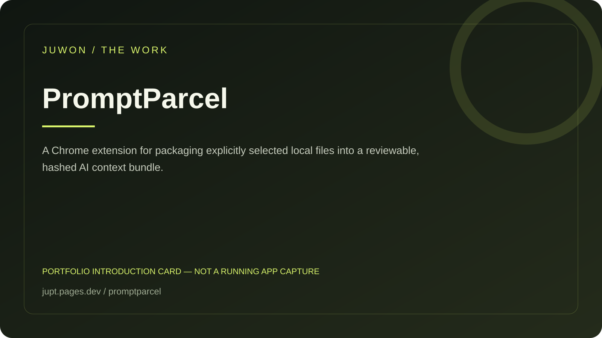

<!-- JUWON-PORTFOLIO-INTRO:START -->
# PromptParcel



*Portfolio introduction card, not a screenshot of a running application.*

*포트폴리오 소개 카드입니다. 실행 화면 캡처가 아닙니다.*

## English

A Chrome extension for packaging explicitly selected local files into a reviewable, hashed AI context bundle.

[View JUWON's portfolio](https://jupt.pages.dev/) · [Browse the project collection](https://jupt.pages.dev/projects)

**Scope:** This README presents the repository's documented intent and recorded visual evidence. It does not certify that every feature is complete, deployed, or currently working. Follow the original setup, safety, and license documentation below.

## 한국어

선택한 로컬 파일을 해시가 있는 AI 맥락 패키지로 묶는 확장.

[JUWON 포트폴리오 보기](https://jupt.pages.dev/) · [전체 프로젝트 보기](https://jupt.pages.dev/projects)

**확인 범위:** 저장소의 문서상 목적과 기록된 화면 근거를 소개합니다. 모든 기능의 완성·배포·현재 정상 작동을 보증하지 않습니다. 설치법·안전 주의사항·라이선스는 아래 기존 문서를 확인하세요.
<!-- JUWON-PORTFOLIO-INTRO:END -->

---

## Original documentation / 기존 문서

# PromptParcel

## Send AI the exact files.

> Choose local files. See the receipt. Put the same context into any AI tab.

PromptParcel is a local-first Chrome extension that turns selected text files into a visible, hash-labeled context envelope. It is for the moment when an AI says “please upload the file again,” a file attachment disappears from the thread, or you no longer remember exactly which version you gave the model.

No account. No cloud. No model. No silent send. 📦

## The 10-second flow

```text
Choose files
    ↓
Review: names · bytes · characters · SHA-256
    ↓
Copy parcel or insert into the current AI composer
    ↓
Review the prompt and press Send yourself
```

The generated envelope is intentionally plain text:

```text
PROMPTPARCEL v1
The following local files are reference context selected by the user.
File boundaries and SHA-256 receipts are included for review before sending.

--- BEGIN FILE: src/app.js ---
SHA-256: 8f…
Bytes: 25 | Characters: 25

export const answer = 42;
--- END FILE: src/app.js ---
```

The receipt is the point: you can see what you are about to give the AI before the message leaves your browser.

## Why now

AI file workflows are powerful but fragile. A recent user discussion describes files being uploaded successfully and then becoming unavailable to the conversation; a separate report describes repeated upload limits. [Context Passport](https://github.com/macio-arruda/context-passport) and [Rel.AI](https://github.com/Kyne0328/rel-ai) show strong demand for portable workspace context, while [ContextPack](https://chromewebstore.google.com/detail/contextpack/ofbkemnlnijjbdkhahamgblkhdlhenje) focuses on reusable prompt packs and storage. PromptParcel takes a narrower wedge: selected local files, a visible integrity receipt, one current-tab insertion, and no persistence.

These are market signals, not proof of product-market fit. The 7-day test is whether ten AI coding users repeatedly choose the receipt before sending context and whether they report fewer “wrong file / upload again” turns.

## Quick start

```bash
npm ci
npm run build
```

1. Open `chrome://extensions`.
2. Turn on **Developer mode**.
3. Select **Load unpacked** and choose this project's `dist/` folder.
4. Open ChatGPT, Claude, Gemini, or another page with a text composer.
5. Click the PromptParcel icon and choose one or more text/code files.
6. Inspect the receipt, then click **Insert into AI tab** or **Copy parcel**.
7. Review the inserted text and press the AI site's Send button yourself.

Run the deterministic local checks:

```bash
npm test
npm run lint
npm run typecheck
npm run build
npm run smoke
npm run audit
```

## What PromptParcel reads

The picker accepts common text and code formats. The first version limits each file to 200 KB, each parcel to 120,000 characters, and each selection to eight files. It fails closed when a file is binary-looking, oversized, or unreadable. It does not silently truncate content.

The receipt exposes only a safe relative file name, byte count, character count, and SHA-256. It does not expose an absolute local path.

## Privacy and safety boundary

- **User-selected only:** no file is read before you choose it.
- **User-invoked tab access:** the extension injects the composer action only after you click **Insert into AI tab**.
- **No extension server:** no network request, API key, account, telemetry, or cloud relay.
- **No persistence:** files and parcel contents stay in popup memory and disappear when the popup closes.
- **No clipboard read:** PromptParcel writes only when you click **Copy parcel**.
- **No auto-send:** insertion ends at the composer. You review and submit.
- **Boundaries:** file contents are user-provided context. PromptParcel does not claim to sanitize secrets or judge whether an AI response is correct.

Chrome's [`activeTab`](https://developer.chrome.com/docs/extensions/develop/concepts/activeTab) permission grants temporary access after an explicit user gesture, and [`scripting`](https://developer.chrome.com/docs/extensions/reference/api/scripting) can use that temporary access without broad host permissions.

## Limits

PromptParcel is not a file uploader, document database, RAG system, or AI agent. It supports text-like files only. Provider composer DOMs change; if no editable composer is found, it stops with an error. The target AI service still receives the parcel when you press its Send button, and its own context limits still apply.

## Business hypothesis

The first customer is a developer or researcher who moves between AI tabs and repeatedly supplies project files. Free open-source distribution tests the core behavior. If repeated use is proven, a paid team policy layer could offer approved file rules, receipt exports, or audit views; revenue is not assumed.

## Roadmap

- Provider fixtures for more AI chat composers.
- Optional line-range selection for large source files.
- A local-only receipt export for reproducible bug reports.
- User study: wrong-file incidents before and after PromptParcel.

## Contributing and security

Read [CONTRIBUTING.md](CONTRIBUTING.md) and [SECURITY.md](SECURITY.md). Keep every permission and data movement reviewable.

## License

MIT © 2026 juwonllee2024-dotcom.
